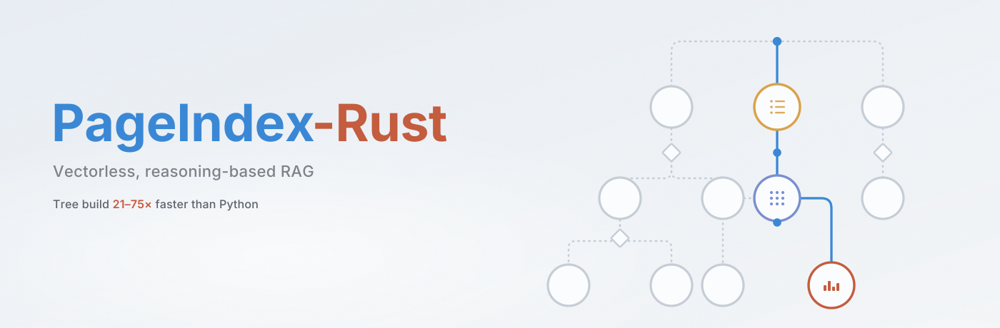

<p align="center">
  
</p>

# PageIndex-Rust

A Rust rewrite of [PageIndex](https://github.com/VectifyAI/PageIndex), the vectorless,
reasoning-based RAG indexer. It turns a PDF or Markdown document into a table-of-contents
tree (`title`, `node_id`, `start_index`, `end_index`, `summary`, `nodes`) that an LLM can
navigate instead of a vector index.

- **Flash** (default): builds the tree from PDF layout statistics, with no LLM involved.
  The parser reads each character with its font, size, and position, then groups text into
  lines and blocks. It then detects headers, footers, contents pages, the title, and
  headings, and assigns heading levels. When the PDF's embedded bookmarks are trustworthy,
  they frame the tree.
- **Classic / standard**: the LLM TOC pipeline (`page_index` / `page_index_main`) — detect
  a printed TOC, recover page numbers, or generate a TOC, then verify, split large nodes,
  merge, and optionally summarize.
- **Optimize**: a deterministic merge driven by worst-case search cost, then an optional
  LLM expand pass.
- **Summaries**: optional LLM node summaries, written bottom-up.
- **Markdown**: `#` headings become nodes, with optional thinning and summaries.
- **Chat / retrieval**: local tool-calling chat over the stored tree (`browse_documents`,
  `get_document`, `get_document_structure`, `get_page_content`, `remove_document`). Cloud
  retrieval (`submit_query` / `get_retrieval`) is unchanged from upstream.
- **Clients**: `PageIndexLocalClient`, `PageIndexCloudClient`, and unified `PageIndexClient`.
- **Agent / MCP**: native tool loop plus OpenAI / Anthropic / Claude MCP adapter JSON;
  `McpBridge` talks to the cloud MCP server (streamable HTTP).
- **Imaging**: `highlight_region` overlays a bbox on a page image (PNG). Cloud page images
  and layout blocks are fetched through the API.

The workspace has three crates:

| Crate | Contents |
|---|---|
| `pageindex-pdf` | Character-level PDF extraction (pure Rust, built on `lopdf`) and bookmark reading |
| `pageindex` | The library: Flash, classic, optimize, summaries, Markdown, chat, cloud, MCP, config, store |
| `pageindex-cli` | The `pageindex` binary, equivalent to upstream's `run_pageindex.py` |

## Build and run

```bash
cargo build --release
# Structure only, no API key needed:
./target/release/pageindex --pdf_path paper.pdf --no-summary --optimize off
# Default run: merge, LLM expand, and summaries (needs a model key):
./target/release/pageindex --pdf_path paper.pdf
./target/release/pageindex --pdf_path paper.pdf --mode standard
./target/release/pageindex --md_path notes.md
```

Results are written to `./results/<name>_structure.json`. The flags match
`run_pageindex.py`; run `pageindex --help` for the full list.

Library use:

```rust
let tree = pageindex::page_index_flash("paper.pdf", &pageindex::FlashOptions::structure_only()).await?;
```

## Configuration

Defaults live in `crates/pageindex/config.yaml`, the same keys and values as upstream.
Model names follow LiteLLM conventions: a bare name is an OpenAI model, and any other
provider is written as `provider/model` (for example `anthropic/claude-sonnet-5-5`,
`openrouter/...`, or `ollama/llama3`).

Supported providers: OpenAI, Anthropic, OpenRouter, Groq, DeepSeek, Mistral, Together,
Fireworks, xAI, Gemini, Ollama.

Secrets come only from the environment or a local `.env` file, which is never committed:

| Variable | Used for |
|---|---|
| `OPENAI_API_KEY` (legacy: `CHATGPT_API_KEY`) | OpenAI models (the default) |
| `OPENAI_BASE_URL` | Any OpenAI-compatible server |
| `ANTHROPIC_API_KEY` | `anthropic/...` |
| `OPENROUTER_API_KEY`, `GROQ_API_KEY`, `DEEPSEEK_API_KEY`, `MISTRAL_API_KEY`, `TOGETHERAI_API_KEY`, `FIREWORKS_API_KEY`, `XAI_API_KEY`, `GEMINI_API_KEY` | Their providers |
| `OLLAMA_API_BASE` | Local Ollama (no key needed) |
| `PAGEINDEX_API_KEY` | PageIndex Cloud |

## Benchmarks

Python PageIndex (upstream checkout, pypdfium2 parser) vs this Rust port on identical
inputs. Release build, Linux, median of 5 timed runs after one warmup. Token counting
is cl100k on the same extracted text (6,334 tokens). E2E is Flash + merge + expand +
summaries with a deterministic stub LLM (`{"subsections": []}` / a fixed summary JSON)
so the numbers do not depend on a network model.

Re-run: `PAGEINDEX_PYTHON=/path/to/PageIndex cargo bench -p pageindex --bench compare`

| Document | Pages | Parse py / rs (ms) | Tree py / rs (ms) | E2E py / rs (ms) | Speedup (tree) |
|---|---:|---:|---:|---:|---:|
| memo | 3 | 2.61 / 0.10 | 4.23 / 0.20 | 4.79 / 0.32 | 20.7× |
| report | 8 | 37.82 / 0.38 | 47.65 / 0.67 | 48.89 / 1.43 | 70.9× |
| deck | 8 | 29.15 / 0.36 | 36.71 / 0.64 | 37.77 / 1.28 | 56.9× |
| book | 26 | 120.2 / 1.25 | 149.8 / 1.99 | 151.5 / 4.48 | 75.3× |
| ja_report | 4 | 46.10 / 0.50 | 49.69 / 0.71 | 50.51 / 1.16 | 69.7× |
| ar_report | 4 | 45.45 / 1.34 | 55.77 / 1.68 | 53.38 / 2.64 | 33.3× |

Token counting (cl100k, 21,238 characters): Python 6,334 tokens in 1.06 ms, Rust 6,334 tokens in 1.72 ms.

Peak RSS in a fresh process per sample (Linux `VmHWM` / `getrusage` `ru_maxrss`), median of 5. Python heap is tracemalloc peak live bytes (Python allocations only, not C extensions). Rust heap is peak live bytes from a counting global allocator in the bench binary; the allocs column is the matching allocation count.

Re-run (speed and memory): `PAGEINDEX_PYTHON=/path/to/PageIndex cargo bench -p pageindex --bench compare`

| Document | Pages | Parse RSS py / rs (MB) | Tree RSS py / rs (MB) | E2E RSS py / rs (MB) | RSS ratio (tree) |
|---|---:|---:|---:|---:|---:|
| memo | 3 | 125.5 / 6.13 | 134.6 / 8.91 | 134.8 / 36.0 | 15.1× |
| report | 8 | 131.4 / 6.54 | 136.1 / 9.41 | 136.2 / 36.4 | 14.5× |
| deck | 8 | 129.8 / 6.45 | 135.8 / 8.83 | 136.0 / 36.1 | 15.4× |
| book | 26 | 144.1 / 7.36 | 145.7 / 10.2 | 145.7 / 37.2 | 14.3× |
| ja_report | 4 | 149.5 / 6.27 | 149.6 / 9.16 | 149.5 / 36.1 | 16.3× |
| ar_report | 4 | 132.1 / 7.11 | 135.2 / 9.88 | 135.4 / 36.9 | 13.7× |

| Document | Pages | Parse heap py / rs (MB) | Tree heap py / rs (MB) | E2E heap py / rs (MB) | Rust allocs (tree) |
|---|---:|---:|---:|---:|---:|
| memo | 3 | 23.8 / 0.63 | 28.1 / 1.69 | 28.1 / 17.9 | 40905 |
| report | 8 | 26.3 / 0.87 | 28.2 / 1.73 | 28.2 / 17.9 | 55145 |
| deck | 8 | 25.6 / 0.83 | 28.4 / 1.62 | 28.4 / 17.8 | 48848 |
| book | 26 | 31.6 / 1.84 | 31.6 / 1.83 | 31.6 / 17.9 | 89485 |
| ja_report | 4 | 33.3 / 0.60 | 33.3 / 1.55 | 33.3 / 17.5 | 49965 |
| ar_report | 4 | 26.3 / 1.75 | 28.1 / 2.35 | 28.1 / 17.5 | 87868 |

## Development

```bash
cargo fmt --all -- --check
cargo clippy --all-targets -- -D warnings
cargo test
```

No `unsafe`. Async is used for I/O and model calls.

## License

MIT, like upstream.
